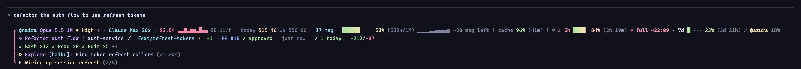

# Claude Code Statusline

Custom statusline for Claude Code that displays AI model information, costs, git status, and development environment details.

To install, just tell Claude Code: 
```
Please configure it for me: https://github.com/galpratama/claude-statusline
```



## Quick Install

### Automatic Installation (for Claude Code / LLMs)

**If you're an AI assistant (Claude Code, ChatGPT, etc.) helping a user install this statusline, follow this complete workflow:**

#### Step 1: Check Prerequisites

First, verify the user has the required dependencies:

```bash
# Check for jq
which jq
# If not found, install based on platform (see Requirements section below)

# Check for bash
bash --version

# Check for git (optional)
git --version
```

#### Step 2: Detect Platform

Determine the user's operating system to provide platform-specific instructions:

```bash
# Detect OS
uname -s
# Returns: Darwin (macOS), Linux, MINGW64_NT (Windows Git Bash), MSYS_NT (Windows MSYS2)
```

#### Step 3: Create Directory Structure

```bash
# Create the statusline directory
mkdir -p ~/Scripts/claude-statusline
cd ~/Scripts/claude-statusline
```

#### Step 4: Download/Copy Files

You need to copy two files to `~/Scripts/claude-statusline/`:
1. **statusline-command.sh** - Main script (required)
2. **statusline-config.json** - Configuration file (required)

**Option A: From Git Repository**
```bash
git clone <repository-url> ~/Scripts/claude-statusline
```

**Option B: Copy from source**
If the files are available locally, copy them:
```bash
cp /path/to/statusline-command.sh ~/Scripts/claude-statusline/
cp /path/to/statusline-config.json ~/Scripts/claude-statusline/
```

**Option C: Create files directly**
If you have the file contents, use the Write tool to create each file.

#### Step 5: Set Permissions

```bash
# Make scripts executable (Unix-like systems)
chmod +x ~/Scripts/claude-statusline/statusline-command.sh
```

#### Step 6: Update Claude Code Settings

Read the existing settings file:
```bash
cat ~/.claude/settings.json
```

If the file doesn't exist, create it:
```bash
mkdir -p ~/.claude
cat > ~/.claude/settings.json << 'EOF'
{
  "statusLine": {
    "command": "/bin/bash $HOME/Scripts/claude-statusline/statusline-command.sh",
    "type": "command"
  }
}
EOF
```

If it exists, merge the statusLine configuration into it. **Important:** Preserve existing settings like `env`, `mcpServers`, etc.

Example merge using jq:
```bash
# Backup first
cp ~/.claude/settings.json ~/.claude/settings.json.backup

# Merge statusLine config
jq '. + {"statusLine": {"command": "/bin/bash $HOME/Scripts/claude-statusline/statusline-command.sh", "type": "command"}}' \
  ~/.claude/settings.json > ~/.claude/settings.json.tmp && \
  mv ~/.claude/settings.json.tmp ~/.claude/settings.json
```

#### Step 7: Verify Installation

Test the statusline script:
```bash
bash ~/Scripts/claude-statusline/statusline-command.sh
```

**Expected output:** A formatted statusline with AI metrics, git info, and dev environment details.

**If you see errors:**
- "jq: command not found" → Install jq (see Requirements section)
- "config file not found" → The statusline-config.json is missing or in wrong location
- Permission errors → Run `chmod +x` on the script files

#### Step 8: Restart Claude Code

The user needs to restart their Claude Code session for the statusline to appear.

#### Complete Installation Script (for copy-paste)

```bash
#!/bin/bash
# Complete statusline installation script for LLMs to use

# Create directory
mkdir -p ~/Scripts/claude-statusline

# NOTE: Files must be copied here by the LLM
# Required files:
# - statusline-command.sh
# - statusline-config.json

# Set permissions
chmod +x ~/Scripts/claude-statusline/statusline-command.sh

# Backup existing settings
if [ -f ~/.claude/settings.json ]; then
    cp ~/.claude/settings.json ~/.claude/settings.json.backup
fi

# Update settings with statusline config
mkdir -p ~/.claude
if [ -f ~/.claude/settings.json ]; then
    # Merge with existing settings
    jq '. + {"statusLine": {"command": "/bin/bash $HOME/Scripts/claude-statusline/statusline-command.sh", "type": "command"}}' \
      ~/.claude/settings.json > ~/.claude/settings.json.tmp && \
      mv ~/.claude/settings.json.tmp ~/.claude/settings.json
else
    # Create new settings file
    cat > ~/.claude/settings.json << 'EOF'
{
  "statusLine": {
    "command": "/bin/bash $HOME/Scripts/claude-statusline/statusline-command.sh",
    "type": "command"
  }
}
EOF
fi

# Verify installation
echo "Testing statusline..."
bash ~/Scripts/claude-statusline/statusline-command.sh

echo ""
echo "Installation complete! Restart Claude Code to see the statusline."
```

### Platform-Specific Installation Notes for LLMs

#### macOS
- Default shell is usually zsh, but bash is available at `/bin/bash`
- `lsof` is pre-installed (preferred for server detection)
- Settings path: `~/.claude/settings.json` (same as Linux)
- Use forward slashes in paths

#### Windows (Git Bash)
- Requires Git Bash environment
- Home directory: `/c/Users/USERNAME/` in Git Bash
- Settings path: `C:\Users\USERNAME\.claude\settings.json` (Windows path) or `~/.claude/settings.json` (Git Bash path)
- Use forward slashes in settings.json
- Example path: `$HOME/Scripts/claude-statusline/statusline-command.sh`

#### Windows (WSL)
- Linux environment on Windows
- Home directory: `/home/username/`
- Settings path can be either WSL path or Windows path
- If accessing Windows files: `/mnt/c/Users/USERNAME/.claude/settings.json`

#### Linux
- Standard Unix paths
- Check shell with: `echo $SHELL`
- Most distributions have bash at `/bin/bash`

### Troubleshooting Guide for LLMs

When helping users, check these common issues:

1. **jq not installed**
   - macOS: `brew install jq`
   - Linux (Debian/Ubuntu): `sudo apt-get install jq`
   - Windows: Guide user to install via chocolatey/scoop/winget

2. **Permission denied**
   - Run: `chmod +x ~/Scripts/claude-statusline/*.sh`
   - Verify: `ls -la ~/Scripts/claude-statusline/`

3. **Config file not found**
   - Ensure statusline-config.json exists
   - Check `STATUSLINE_CONFIG_FILE` near the top of statusline-command.sh
   - Default location: `$HOME/Scripts/claude-statusline/statusline-config.json`

4. **Settings.json syntax error**
   - Validate JSON: `cat ~/.claude/settings.json | jq .`
   - Common issues: missing commas, trailing commas, unescaped quotes

5. **Statusline not appearing**
   - User must restart Claude Code after installation
   - Check settings.json has correct path
   - Test script manually: `bash ~/Scripts/claude-statusline/statusline-command.sh`

6. **Git info not showing**
   - User must run Claude Code from within a git repository
   - Check: `git status` in working directory

### Manual Installation

1. **Clone or download this repository:**
   ```bash
   git clone <repository-url> ~/Scripts/claude-statusline
   # OR
   mkdir -p ~/Scripts/claude-statusline
   # Then copy statusline-command.sh and statusline-config.json
   ```

2. **Make scripts executable:**
   ```bash
   chmod +x ~/Scripts/claude-statusline/statusline-command.sh
   ```

3. **Configure Claude Code:**

   Edit `~/.claude/settings.json` and add:
   ```json
   {
     "statusLine": {
       "command": "/bin/bash $HOME/Scripts/claude-statusline/statusline-command.sh",
       "type": "command"
     }
   }
   ```

4. **Customize configuration (optional):**

   Edit `~/Scripts/claude-statusline/statusline-config.json` to customize:
   - Subscription renewal dates
   - Monitored ports
   - Ignored ports
   - Display segments

5. **Test the statusline:**
   ```bash
   bash ~/Scripts/claude-statusline/statusline-command.sh
   ```

## Files

- **statusline-command.sh** - Main statusline script that generates the status display
- **statusline-config.json** - Configuration file for statusline behavior and settings

## Requirements

### Core Dependencies

- **Bash** - Standard bash shell (pre-installed on macOS/Linux, use Git Bash on Windows)
- **jq** - JSON processor for reading config files
- **git** - For git status information (optional but recommended)
- **lsof** or **netstat** - For server detection (usually pre-installed)
- **ripgrep** (`rg`) - Optional; much faster transcript scanning on long sessions (`brew install ripgrep`)

### Installing jq

#### macOS

Using Homebrew (recommended):
```bash
brew install jq
```

Using MacPorts:
```bash
sudo port install jq
```

Download binary directly:
1. Visit https://jqlang.github.io/jq/download/
2. Download the macOS binary
3. Move to `/usr/local/bin/jq` and make executable:
   ```bash
   sudo mv ~/Downloads/jq-macos-* /usr/local/bin/jq
   chmod +x /usr/local/bin/jq
   ```

#### Windows

**Option 1: Using Chocolatey (recommended)**
```powershell
choco install jq
```

**Option 2: Using Scoop**
```powershell
scoop install jq
```

**Option 3: Using winget**
```powershell
winget install jqlang.jq
```

**Option 4: Manual Installation**
1. Download from https://jqlang.github.io/jq/download/
2. Download `jq-windows-amd64.exe`
3. Rename to `jq.exe`
4. Place in a directory in your PATH (e.g., `C:\Windows\System32\` or `C:\Program Files\jq\`)

**For Git Bash on Windows:**
```bash
# Create a bin directory in your home
mkdir -p ~/bin

# Download jq for Windows
curl -L -o ~/bin/jq.exe https://github.com/jqlang/jq/releases/latest/download/jq-windows-amd64.exe

# Add to PATH in ~/.bashrc
echo 'export PATH="$HOME/bin:$PATH"' >> ~/.bashrc
source ~/.bashrc

# Verify installation
jq --version
```

#### Linux

**Debian/Ubuntu:**
```bash
sudo apt-get update
sudo apt-get install jq
```

**Fedora/RHEL/CentOS:**
```bash
sudo dnf install jq
# or
sudo yum install jq
```

**Arch Linux:**
```bash
sudo pacman -S jq
```

**Alpine Linux:**
```bash
apk add jq
```

### Platform-Specific Notes

#### Windows

- **Git Bash** is required for running bash scripts on Windows
  - Install from https://git-scm.com/downloads
  - The statusline will run in Git Bash environment

- Path format in settings.json should use forward slashes:
  ```json
  {
    "statusLine": {
      "command": "/bin/bash $HOME/Scripts/claude-statusline/statusline-command.sh",
      "type": "command"
    }
  }
  ```

- If using WSL (Windows Subsystem for Linux):
  ```bash
  # Install jq in WSL
  sudo apt-get install jq

  # Use WSL path in settings.json
  "command": "/bin/bash /mnt/c/Users/YourUsername/Scripts/claude-statusline/statusline-command.sh"
  ```

#### macOS

- Bash 3.2+ is included by default (works with the statusline)
- For newer bash versions, install via Homebrew: `brew install bash`
- `lsof` is pre-installed and preferred for server detection

#### Linux

- Most distributions include bash and basic utilities by default
- Use your package manager to install missing dependencies
- Both `lsof` and `netstat` are typically available

## Configuration

The statusline is configured in two places:

### 1. Claude Code Settings (`~/.claude/settings.json`)

This tells Claude Code where to find the statusline script:

```json
{
  "statusLine": {
    "command": "/bin/bash $HOME/Scripts/claude-statusline/statusline-command.sh",
    "type": "command"
  }
}
```

**Note:** Use `$HOME` instead of `~` or absolute paths for better portability.

### 2. Statusline Configuration (`~/Scripts/claude-statusline/statusline-config.json`)

This controls what the statusline displays and how it behaves. See [Customization](#customization) section below.

## Features

### AI Metrics
- Model name, effort level (`◆ High`), fast mode (`↯ fast`) and thinking (`✻`) indicators
- Claude plan from your account (`Claude Team 5x`, `Claude Max 20x`, `Claude Pro`)
- Session cost (reported by Claude Code, estimated from pricing tables otherwise), a sparkline of cost per message (`▃▃▇▃▆▅`) and burn rate per hour of active API time (`$8.11/h`)
- Spend across all sessions: `today $15.46 wk $56.66` (rolling 7 days), from a per-day ledger in `~/.cache/claude-statusline/`. Sessions spanning midnight split their cost between days. Only sessions rendered since the ledger existed are counted
- Context trend sparkline (`▁▂▃▄▅`, drops show compactions)
- Context usage as a smooth gradient bar (`█▋········ 18%`, 1/8-cell precision, green → yellow → red) and, from 50% on, an estimate of messages left (`~14 msg left`) from a moving average of per-message context growth
- Prompt cache hit ratio and time until the cache goes cold
- 5-hour and 7-day usage limits with mini bars, reset countdowns and a run-out projection (`→ full ~16:40`) when the current burn rate would hit the limit before the reset

### Alerts
Context ≥85%, cache expiring within 5 minutes, a usage limit ≥90% or projected to run out are shown bold with `⚠`, and the gutter turns red.

### Multiple Accounts
Sessions launched with `CLAUDE_CONFIG_DIR` (one config dir per account) show the account (`@naira`, the email's local part) in a stable per-account color, and the plan label comes from that account. Each account records its last-seen limits in `~/.cache/claude-statusline/quota-<account>.tsv`; when the current account nears a limit (5h ≥80% or projected to run out, 7d ≥90%), the line suggests the other account with the most 5h headroom (`⇄ @azura 12%`). Limit notifications name that account too. A window past its reset counts as 0%. The badge appears once two or more accounts have reported.

### Notifications
A macOS notification (once per usage window / session) when a usage limit hits 90% or is projected to run out before it resets, and when context reaches 90%. Disable with `"features": {"notifications": false}`.

### Modes
`full` (default), `compact` (first two lines) or `zen` (one line: model, cost, context, limits + alerts). Switch for every session with `~/Scripts/claude-statusline/statusline-command.sh --mode zen`, or per process with `STATUSLINE_MODE=zen`.

### Adaptive Layout
Lines are fitted to the terminal width (`$COLUMNS`, passed by Claude Code). On narrow terminals the least important segments drop first (duration, provider, token counts…); alerts drop last, model and directory never.

### Truecolor
Gradients use 24-bit color when `COLORTERM` is `truecolor`/`24bit`, otherwise the 16-color palette. Force 16 colors with `STATUSLINE_TRUECOLOR=0`.

### Themes
Set `display.theme` in `~/.claude/statusline-config.json` to `catppuccin`, `tokyonight`, `dracula`, `nord` or `rosepine` (truecolor only; gradients follow the theme). `default` keeps your terminal's palette.

### Currency
Set `display.currency` to `idr` to show costs (session, burn rate, today/week spend) in short rupiah (`Rp850`, `Rp12.3k`, `Rp1.34M`); `usd` (default) keeps dollars. The USD→IDR mid-market rate comes from Yahoo Finance (`USDIDR=X`, fallback open.er-api.com), cached in `~/.cache/claude-statusline/usd-idr` and refreshed in the background hourly; until the first fetch lands, costs stay in USD.
- Message count, MCP servers count
- Honcho memory activity (`🧠 ←5 ↑24 ✓12`: conclusions recalled for the last prompt, tool events captured, messages saved), read from `~/.honcho/status-<session_id>.json`. Upstream Honcho doesn't write this file; it needs a local patch to its hooks

### Live Activity
- Running tool with target and elapsed time
- Running subagents (including background agents) with type, model and description
- Completed tools (top 3, MCP names shortened like `honcho:get_config`)
- Current todo and progress

### Git Information
- Current branch, dirty marker, sync status (`=`, `↑2`, `↓1`)
- Added/removed files, last commit age, commits today
- Open PR for the branch with CI checks and review state (`PR #18 ✓ approved`), via `gh`, refreshed in the background at most once a minute
- Stash count (`⚑ 2 stash`, toggle `segments.git.show_stash`) and running Docker containers (`🐳 3`, toggle `segments.dev.show_docker`, refreshed in the background)

### Development Environment
- Session name
- Detected language/framework and package manager
- Running servers on configured ports
- Subscription renewal tracking

### Performance
Renders in ~0.3s, even on long sessions: input, config and the transcript summary are each read with a single `jq` call, git info (incl. branch and stash) uses one `git status --porcelain=v2 --show-stash` call, slow probes (servers, PR, docker) refresh in the background, and the transcript scan only JSON-parses tool calls. Install [ripgrep](https://github.com/BurntSushi/ripgrep) for the fastest transcript scanning on very large sessions.

## Customization

### Subscription Dates

Edit `statusline-config.json` to update subscription renewal dates:

```json
"subscriptions": {
  "Claude": {
    "type": "monthly",
    "renewal_date": "2025-12-22"
  }
}
```

### Listened Ports

Customize which ports to monitor for running servers:

```json
"features": {
  "listened_ports": [3000, 5173, 8000, 8080],
  "ignored_ports": [80]
}
```

- **listened_ports**: Ports to check for running servers
- **ignored_ports**: Ports to exclude from statusline display (even if running)

**Common ports included by default:**
- `80` - HTTP (often ignored)
- `3000, 3001` - Node.js/React dev servers
- `3306` - MySQL
- `4200` - Angular dev server
- `5173, 5174` - Vite dev servers
- `5432` - PostgreSQL
- `6379` - Redis
- `8000, 8001, 8080` - Common HTTP dev servers
- `8888` - Jupyter Notebook
- `9000` - Various dev tools

### Display Options

Toggle features on/off in `statusline-config.json`:

```json
"segments": {
  "ai": {
    "show_cost": true,
    "show_cache_efficiency": true
  }
}
```

## Pricing

The statusline includes up-to-date pricing for all major AI providers (as of December 2025):
- OpenAI (GPT-3.5, GPT-4, GPT-5 family)
- Anthropic Claude (Haiku, Sonnet, Opus 4.5)
- Google Gemini (1.5, 2.0, 2.5)
- DeepSeek (Chat, Reasoner/R1)
- Kimi/Moonshot AI
- GLM (Zhipu AI)
- MiniMax

Pricing data is automatically calculated based on model ID patterns, no provider detection needed.

## Troubleshooting

### Statusline not appearing

1. **Check if settings.json is properly formatted:**
   ```bash
   cat ~/.claude/settings.json | jq .
   ```
   If you get an error, fix the JSON syntax.

2. **Verify the script path exists:**
   ```bash
   ls -la ~/Scripts/claude-statusline/statusline-command.sh
   ```

3. **Test the script manually:**
   ```bash
   bash ~/Scripts/claude-statusline/statusline-command.sh
   ```
   This should output the statusline. If you see errors, check the error messages.

4. **Check for jq:**
   ```bash
   which jq
   ```
   If not found: `brew install jq` (macOS) or `apt-get install jq` (Linux)

### Config file not found errors

If you see "config file not found" errors:

```bash
# Verify config exists
ls -la ~/Scripts/claude-statusline/statusline-config.json

# If missing, copy from example or create a minimal config:
cat > ~/Scripts/claude-statusline/statusline-config.json << 'EOF'
{
  "version": "1.0.0",
  "features": {
    "server_detection": true,
    "listened_ports": [3000, 5173, 8000, 8080],
    "ignored_ports": [80]
  },
  "subscriptions": {}
}
EOF
```

### Permission denied errors

```bash
# Make scripts executable
chmod +x ~/Scripts/claude-statusline/*.sh
```

### Git information not showing

Ensure you're running Claude Code from within a git repository:
```bash
cd /path/to/your/git/repo
claude
```

## Examples

### Example Output

```
╭ Opus 5.5 1M ◆ High ✻ · Claude Team 5x · $2.84 · 45m · 37 msg ┊ ▰▰▱▱▱▱▱▱▱▱ 18% (182.2k/1M) ┊ cache 96% (42m) ┊ ◴ 5h 41% (2h 19m) · 7d 23% (3d 22h)
│ ◇ Refactor auth flow ┊ claude-statusline ⎇  main * = · 9m ago · ✓ 4 today · +212/-87 ┊ 🔌 5
│ ✓ Bash ×12 ✓ Read ×8 ✓ Edit ×5 +1
│ ◓ Explore [haiku]: Find token refresh callers (2m 18s)
╰ ▸ Wiring up session refresh (2/4)
```

**Reading the output:**

**Line 1 (AI):** model and context size, effort level, thinking on, plan, session cost, duration, message count, context bar, prompt cache hit ratio (and minutes until it goes cold), 5h/7d usage with reset countdowns.

**Line 2 (Session & Git):** session name, directory, branch, dirty marker, in sync with upstream, last commit 9 minutes ago, 4 commits today, lines added/removed this session, 5 MCP servers.

**Activity lines (only when active):** completed tools, a running subagent, the current todo with progress.

### Minimal Configuration Example

```json
{
  "version": "1.0.0",
  "features": {
    "server_detection": true,
    "listened_ports": [3000, 8000],
    "ignored_ports": []
  }
}
```

### Full Configuration Example

```json
{
  "version": "1.0.0",
  "segments": {
    "ai": {
      "enabled": true,
      "show_cost": true,
      "show_cache_efficiency": true
    },
    "git": {
      "enabled": true,
      "show_branch": true
    },
    "dev": {
      "enabled": true,
      "show_running_servers": true
    }
  },
  "features": {
    "server_detection": true,
    "listened_ports": [3000, 5173, 8000, 8080],
    "ignored_ports": [80]
  },
  "subscriptions": {
    "Claude": {
      "type": "monthly",
      "renewal_date": "2025-12-22"
    }
  }
}
```

## Honcho Patch

If you use the [Honcho](https://github.com/plastic-labs/claude-honcho) memory plugin, `patch-honcho.py` hides its per-turn notices (`[honcho] … captured / saved / injected`) and makes its hooks write the `~/.honcho/status-<session_id>.json` file behind the `🧠` segment. Plugin updates overwrite the patch, so re-run it after each Honcho update:

```bash
python3 ~/Scripts/claude-statusline/patch-honcho.py
```

To make this automatic, register `session-start-hook.sh` as a SessionStart hook in `~/.claude/settings.json`. It runs the patch silently (a message appears only when the plugin was updated and re-patched, or a patch failed) and moves Honcho/statusline per-session files older than 7 days to the Trash:

```json
"hooks": {
  "SessionStart": [
    { "hooks": [{ "type": "command", "command": "/bin/bash $HOME/Scripts/claude-statusline/session-start-hook.sh", "timeout": 30 }] }
  ]
}
```

It finds the newest installed Honcho version, skips patches that are already applied, keeps a `.orig` backup of each file, and restores a file if `node --check` fails. A `!` line means the plugin's code changed and that patch needs updating.

## Contributing

Found a bug or want to add a feature? Contributions are welcome!

## License

This statusline is provided as-is for use with Claude Code.
